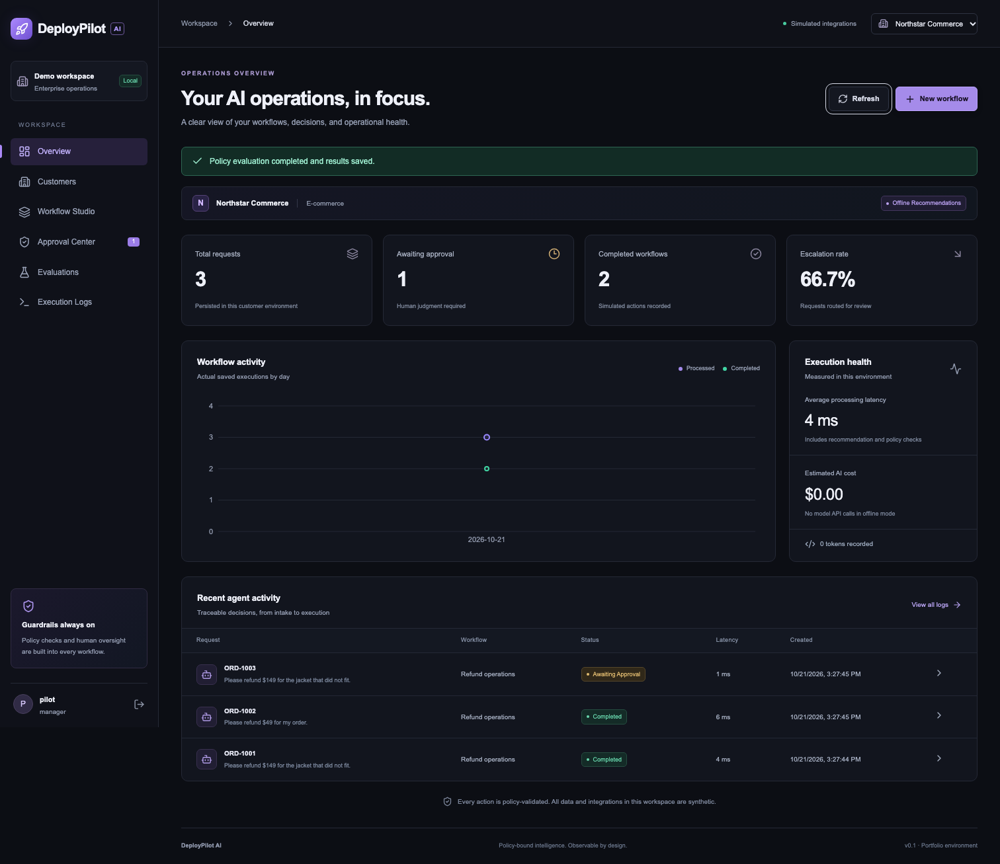
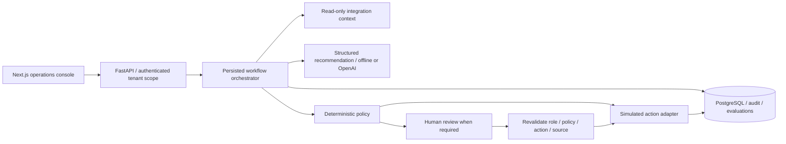

<div align="center">

# DeployPilot AI

### Enterprise agent deployment & operations platform

Configure, deploy, evaluate, and monitor AI workflows for multiple enterprise customers from one intelligent control center.

**One shared application. Customer-specific policies. Human-controlled execution.**

[Product requirements](docs/PRD.md) · [Architecture](docs/ARCHITECTURE.md) · [Demo script](docs/DEMO_SCRIPT.md) · [Measured evaluations](evaluations/reports/latest.md)

</div>



**Hosted demo:** placeholder — not deployed. **90-second video:** placeholder — not yet recorded.

DeployPilot is a working portfolio application for forward deployed and applied AI engineering. It demonstrates how to adapt an AI workflow to different enterprise customers while keeping money, permissions and final actions under deterministic backend control. All records and actions are synthetic. Offline mode runs without an API key and is labeled throughout the interface.

## Two customers, one platform

| Customer | Workflow | Backend guardrails | Simulated result |
|---|---|---|---|
| Northstar Commerce | Refund operations | 30-day window, original payment method, remaining order balance, manager approval above $100 | Database-recorded refund |
| OrbitCloud SaaS | Support triage | Verified source identity, security review for privileged recovery, no credential-reset tool | Documentation draft or escalation |

Switching customer changes the authenticated tenant scope, policies, source records, role and dashboard metrics. A customer ID in a workflow body cannot grant access. Model recommendations never override the policy engine.

## What works

- **Overview:** request counts, pending reviews, completed actions, escalation rate, latency, tokens, estimated cost and activity calculated from saved runs.
- **Customer configurations:** versioned policies, approval limits and mock integration inventory.
- **Workflow Studio:** example/custom requests, retrieved context, structured recommendation, deterministic decision and execution timeline.
- **Approval Center:** role-authorized approve/reject, action and policy binding, source revalidation and persisted review history.
- **Evaluations:** 60 labeled policy/adapter cases, measured results, failure categories and tenant-scoped run history. Unmeasured LLM metrics remain explicitly unavailable.
- **Execution Logs:** request, model/prompt provenance, tool calls, policy decisions, state transitions, approvals and final simulated effects.

Six console views share a single responsive Next.js page. [Workflow screenshot](demo/workflow-studio.png) · [OrbitCloud screenshot](demo/orbit-overview.png) · [Mobile screenshot](demo/mobile.png)

## Architecture



The backend is a modular monolith. PostgreSQL row locks serialize competing refunds and approval decisions. Unique constraints prevent duplicate request keys and executed actions. The model has only a bounded read-only context tool. Real integrations would require provider idempotency and a transactional outbox.

## Stack

Next.js App Router 16.4.2 · React 19.3.1 · TypeScript · Tailwind CSS 4 · locally owned shadcn/ui-style button primitives · Recharts · Lucide · Python 3.13 · FastAPI · Pydantic · SQLAlchemy 2 · Alembic · PostgreSQL 18 (Compose) · OpenAI Responses API · Docker Compose · Pytest · Playwright · GitHub Actions.

Dependency versions are locked in `requirements.lock` and `apps/web/package-lock.json`. SDK usage follows the [official structured-output documentation](https://developers.openai.com/api/docs/guides/structured-outputs?api-mode=responses). The [Next.js installation guide](https://nextjs.org/docs/app/getting-started/installation) documents its App Router setup.

## Quick start with Docker

```bash
git clone https://github.com/ShreyaMP1999/deploypilot-ai.git
cd deploypilot-ai
cp .env.example .env
# Edit .env: choose DEMO_PASSWORD, POSTGRES_PASSWORD and a random JWT_SECRET.
# Generate a signing secret: python -c 'import secrets; print(secrets.token_hex(32))'
docker compose up --build -d --wait
```

Open [the console](http://localhost:3000) and [API documentation](http://localhost:8000/docs). Migrations and 48 synthetic order/ticket records seed automatically. Sign in as `pilot` using the password you configured. `analyst` uses the same seed password and has read-only access. No fixed production credential is embedded in the frontend.

Keep `AGENT_MODE=offline` for a no-key demo. For live recommendations set `AGENT_MODE=live` and `OPENAI_API_KEY` on the backend; optionally configure model and cost rates. Never put the API key in a `NEXT_PUBLIC_` variable.

For Python/Node development, SQLite, environment variables, production commands and Render/Vercel deployment guidance, see [deployment instructions](docs/DEPLOYMENT.md).

## Try the workflows

1. **Refund with review:** Northstar → Workflow Studio → Approval example (`ORD-1001`, $149) → Execute → inspect policy → Approval Center → Approve & process → inspect the recorded refund.
2. **Automatic refund:** choose the Automatic example (`ORD-1002`, $49). Repeated refunds cannot exceed the remaining order value.
3. **Privileged recovery:** switch to OrbitCloud → execute the default privileged ticket → security approval → inspect the simulated escalation. Credentials never change.
4. **Documentation draft:** choose Orbit's Automatic example. The mock adapter records a draft rather than a privileged operation.
5. **Evidence:** run the policy suite from Evaluations and inspect individual runs in Execution Logs.

The synthetic order balance persists. To repeat the complete demo, use fresh synthetic data or select an unused order; the app correctly rejects over-refunding a previously used order.

## Test and evaluation methodology

```bash
python3 -m venv .venv
source .venv/bin/activate
pip install -r requirements.lock
# Configure .env, then:
alembic upgrade head
python -m backend.db.seed
ruff check backend apps/api tests
pytest -q
python -m backend.evaluations.runner
cd apps/web
npm ci
npm run build
npm run typecheck
```

**Observed locally:** 90 tests passed on PostgreSQL 18, including two concurrent-session tests. SQLite: 88 passed, with those two PostgreSQL-only tests skipped. The 60 independent policy/adapter labels match their expected outcomes. These checks do not establish real-world LLM accuracy or business ROI. See [verification details](docs/EVALUATION_REPORT.md) and [measured JSON](evaluations/reports/latest.json).

The evaluation harness is read-only and never executes financial or account actions. Reports preserve dataset, model and prompt provenance. Classification accuracy, unauthorized action rate and end-to-end completion are null in the pure deterministic evaluation because it does not measure them; API tests separately verify permission and execution behavior. Run paid live recommendations explicitly with `python -m backend.evaluations.runner --live` after configuring a key. No live model evaluation is claimed.

## Repository map

```text
apps/api/                  FastAPI endpoints and container
apps/web/                  Next.js console, UI primitives, browser verification
backend/agents/            Structured recommendation and bounded read-only tool
backend/policies/          Pure deterministic decisions
backend/workflows/         State machine, orchestration and approval revalidation
backend/integrations/      Synthetic source and action adapters
backend/evaluations/       Read-only evaluation runner
backend/db/                SQLAlchemy entities, sessions and seed command
backend/auth.py            Password hashes, signed sessions and membership checks
backend/analytics.py       Calculated tenant metrics
configs/                   Two customer configurations
migrations/                Frozen Alembic schema
tests/                    Policy, API, security and PostgreSQL concurrency checks
evaluations/              60 labels and measured JSON/Markdown reports
docs/                     Product, engineering, deployment and demo artifacts
demo/                     Captured screenshots
.github/workflows/         Backend, frontend and container CI
```

## Product and engineering artifacts

[PRD](docs/PRD.md) · [Architecture and security model](docs/ARCHITECTURE.md) · [Fictional customer deployment case study](docs/CUSTOMER_CASE_STUDY.md) · [Product decisions](docs/PRODUCT_DECISIONS.md) · [Evaluation report](docs/EVALUATION_REPORT.md) · [Roadmap](docs/ROADMAP.md) · [90-second demo script](docs/DEMO_SCRIPT.md) · [Deployment guide](docs/DEPLOYMENT.md).

The project demonstrates customer-specific requirements translation, adapter boundaries, applied structured AI, deterministic authorization, human accountability and measurable operational evidence. Business-value hypotheses are identified as hypotheses rather than fabricated customer outcomes.

## Limits and next steps

This is a production-style portfolio MVP, not a production-certified service. Seeded password authentication, in-process rate limiting, application-layer tenant isolation and database audit records need enterprise hardening. Sessions are held in browser memory and expire on refresh. Policies are read-only in the UI. Model calls run synchronously, provider failures can undercount billable usage, and cost estimates require operator-supplied rates. Logs show the latest 100 executions; the approval queue also uses that window. Public hosting and video recording are not included.

Next: OIDC and reviewer separation, durable workers/outbox, database row-level security, controlled policy publishing, larger live-model evaluations and sandbox enterprise integrations. See the roadmap for adoption gates.

## License

[MIT](LICENSE).
