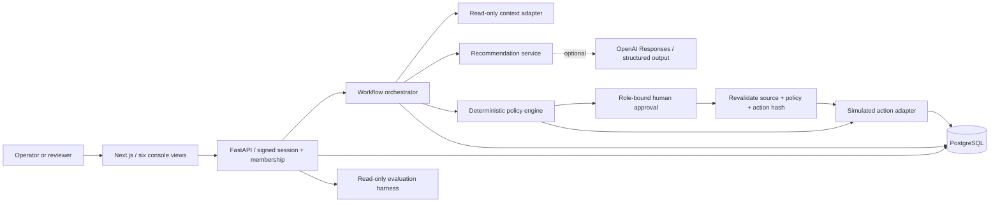
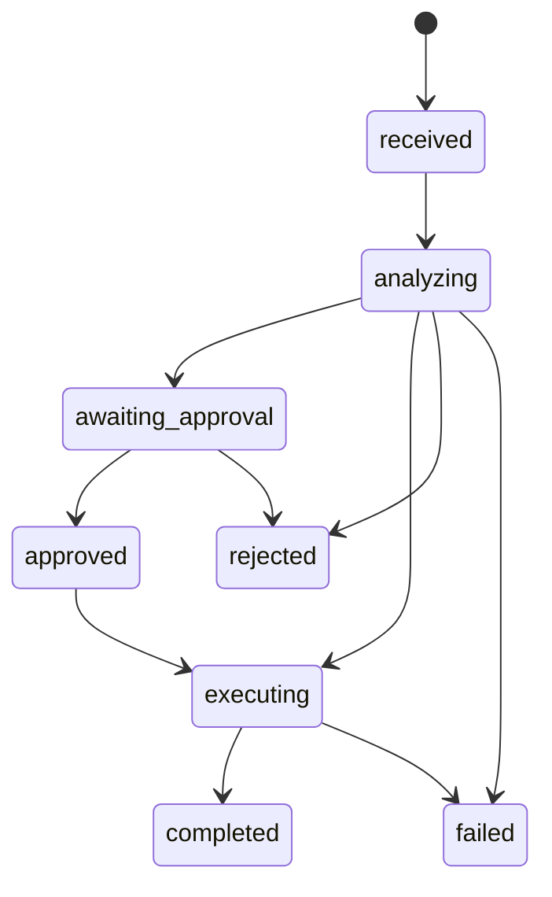

# Architecture

DeployPilot is a modular monolith: a Next.js console talks to a FastAPI API; the API owns authentication, tenant scope, policy evaluation, orchestration and synthetic integrations. SQLAlchemy persists all workflow and approval records in PostgreSQL. SQLite is a convenient offline developer option; concurrency guarantees are verified on PostgreSQL.

## Responsibilities and data flow
1. Authenticate a seeded user with a PBKDF2 password hash. Issue a short-lived HS256 session, scoped to one tenant. Every protected request reloads membership and role from the database.
2. Save a request with a tenant-unique idempotency key; bind a run to the current policy version.
3. Retrieve only the selected tenant's source record. Customer text cannot select arbitrary external tools or grant permissions.
4. Generate a Pydantic-validated recommendation. In live mode a bounded, read-only `retrieve_context` tool call precedes the structured recommendation. Offline mode explicitly uses deterministic recommendations.
5. Evaluate amount, purchase age, remaining balance, original payment requirement, delivery status, identity and request risk in Python.
6. Deny, execute or persist a role-specific approval. The pending record contains an SHA-256 action fingerprint and policy ID.
7. On approval, lock the run and approval, verify role/current state, compare current policy and fingerprint, and re-read the source. The adapter locks the order and rechecks remaining balance. Record the simulated action and state transition in the same transaction.
8. Calculate metrics and expose append-only-through-the-API audit events. No endpoint edits or deletes audit records.

## Persisted entities
`tenants`, `tenant_configurations`, `policies`, `users`, `memberships`, `integration_records`, `requests`, `agent_runs`, `approvals`, `executed_actions`, `audit_events`, `evaluation_cases`, `evaluation_runs`. Foreign keys, tenant indexes, unique policy versions, tenant/idempotency keys and unique executed action per run are defined in the frozen initial Alembic migration.

Tenant isolation lives in server-side query predicates and membership dependencies. Composite ownership constraints and PostgreSQL row-level security are future defense-in-depth improvements; the database application role can currently see every tenant. The record adapter always uses a composite tenant/record key.

## State machine

Completed, failed and rejected runs are terminal. Changed policies or action proposals return 409 and require a new request. Missing context routes a review task; approval of that task only records an escalation and never turns missing facts into a refund.

## Deployment architecture
Local Compose provides PostgreSQL 18, one API process and a standalone Next.js server. Ports bind to loopback. API startup runs migrations and idempotent seed. For cloud deployment, run migrations once as a release job; deploy the console to Vercel and API to Render with a private managed PostgreSQL connection and explicit HTTPS CORS origins.

## Security and reliability trade-offs
- JWTs stay in React memory, disappear on refresh and are never stored in localStorage. This is a small demo session model, not enterprise identity.
- No credential reset or real payment tool exists. Prompt injection cannot select an execution function.
- The order balance update and mock action insertion share the workflow transaction. A real external adapter needs an outbox and provider idempotency; a database rollback cannot undo a real payment.
- PostgreSQL row locks and unique constraints serialize duplicate approvals and competing refunds; tests exercise actual concurrent sessions.
- Audit records are immutable through the API, not cryptographically tamper-proof. A database administrator can change them.
- Synchronous model calls simplify traces but hold database transactions. A production worker should persist intake before analysis, implement leases/recovery and cap provider spend.
- Structured logs omit request text and credentials. Traces retain synthetic request/context data and have no retention service yet.
- In-process rate limiting suits one API worker. It is not a distributed abuse control.
- Token-cost estimates use configured rates and successful response usage. Provider calls failing after partial billing may be undercounted; reconcile against vendor usage for financial reporting.
